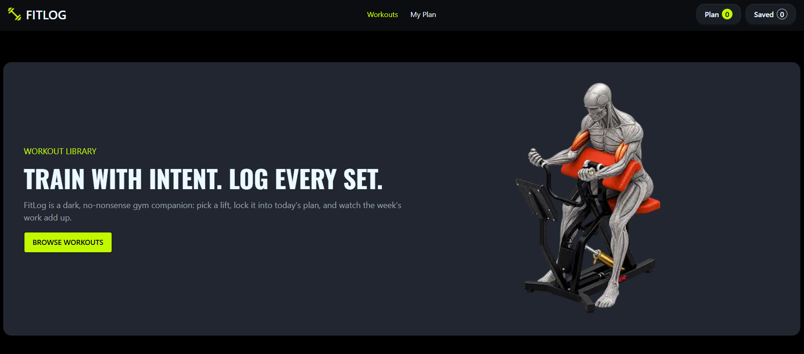

# 🏋️ FitLog — Your Fitness, Your Progress

<p align="center">
  A modern fitness application to explore workouts, plan daily exercises, and manage personal fitness routines.
</p>

<p align="center">
  <a href="https://fitlog-assignment-6-tau.vercel.app/">🌐 Live Website</a> |
  <a href="https://github.com/rasheduldev/fitlog">📂 GitHub Repository</a>
</p>

---

## 📖 About the Project

**FitLog** is a modern fitness web application that helps users explore available workouts, organize daily exercises, and manage their personal workout plans.

It features a clean and responsive interface with a dark theme and vibrant lime-green accents, providing a simple and enjoyable workout planning experience.

## 📸 Project Screenshot

<!-- Add your actual project screenshot here -->



## ✨ Key Features

- 🏋️ **Explore Workouts:** Browse available exercises and discover different workout options.
- 📋 **Workout Planning:** Add exercises to your personal workout plan.
- 🎯 **My Plan:** View and manage your planned workouts in one place.
- 🔢 **Workout Tracking:** Keep track of your selected workout plans.
- 🎨 **Modern UI:** Enjoy a clean, responsive dark interface with vibrant lime-green accents.
- 🔔 **Toast Notifications:** Receive instant feedback when performing actions.

## 🛠️ Technologies Used

- Next.js
- React
- JavaScript
- Tailwind CSS
- DaisyUI
- React Icons
- React Toastify

## 📦 Dependencies

### Main Dependencies

| Package | Purpose |
|---|---|
| next | React framework |
| react | User interface library |
| react-dom | React DOM rendering |
| daisyui | UI component library |
| react-icons | Icons |
| react-toastify | Toast notifications |

### Development Dependencies

| Package | Purpose |
|---|---|
| tailwindcss | Utility-first CSS framework |
| @tailwindcss/postcss | Tailwind CSS integration |
| typescript | TypeScript support |
| eslint | Code linting |
| eslint-config-next | Next.js ESLint configuration |
| @types/node | Node.js type definitions |
| @types/react | React type definitions |
| @types/react-dom | React DOM type definitions |

## 🚀 Installation and Setup

Follow these steps to run the project locally.

### Prerequisites

- Node.js
- npm
- Git

### 1. Clone the Repository

```bash
git clone https://github.com/rasheduldev/fitlog.git
```

### 2. Navigate to the Project Folder

```bash
cd fitlog
```

### 3. Install Dependencies

```bash
npm install
```

### 4. Run the Development Server

```bash
npm run dev
```

Open [http://localhost:3000](http://localhost:3000) in your browser.

### 5. Build for Production

```bash
npm run build
```

### 6. Run the Production Server

```bash
npm run start
```

### 7. Run ESLint

```bash
npm run lint
```

## 🌐 Live Project

- **Live Website:** https://fitlog-assignment-6-tau.vercel.app/
- **GitHub Repository:** https://github.com/rasheduldev/fitlog

## 👨‍💻 Author

**Rashedul Alam Rashed**

- GitHub: [@rasheduldev](https://github.com/rasheduldev)
- Email: [rashedulalam2k04@gmail.com](mailto:rashedulalam2k04@gmail.com)

---

<p align="center">
  Made with ❤️ by Rashedul Alam Rashed
</p>
